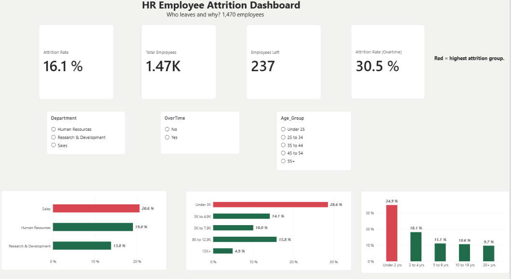

# HR Employee Attrition Analysis

An end-to-end analysis of the IBM HR Employee Attrition dataset (1,470 employees),
from data cleaning in Excel to an interactive Power BI dashboard.

## Business Question
Who leaves the company, and what factors are linked to attrition?

## Tools
- Excel (Power Query-style cleaning, lookup tables, audit log, COUNTIF checks)
- Power BI (DAX measures, slicers, interactive visuals)

## Data Cleaning (Excel)
- Removed low-correlation columns: DailyRate, HourlyRate, MonthlyRate (39 columns remain)
- Created grouped columns: Age_Group, Income_Group, Tenure_Group using a Lookup sheet
- Built an Audit_Log sheet to verify group counts (each totals 1,470)

## Dashboard (Power BI)
- KPI cards: Attrition Rate (16.1%), Total Employees (1,470), Employees Who Left (237)
- Attrition rate by Department, Income Group, and Tenure Group
- Slicers: Department, OverTime, Age Group
- DAX measure: Attrition Rate = DIVIDE(CALCULATE(COUNTROWS(tblClean), tblClean[Attrition] = "Yes"), COUNTROWS(tblClean))

## Key Findings
- Overall attrition rate is 16.1% (237 of 1,470 employees).
- Employees with under 2 years of tenure leave the most (34.9%), falling to 9.7% at 20+ years.
- Employees earning under 3K have a 28.6% attrition rate vs 4.9% for 13K+.
- Sales has the highest attrition (20.6%), followed by HR (19.0%) and R&D (13.8%).

## Recommendations
- Strengthen onboarding and check-ins during the first two years.
- Review compensation for the lowest income bands.
- Investigate the causes of attrition in the Sales department.

## Files
- HR_Attrition_Clean.xlsx: cleaned data, lookup tables, audit log
- HR_Attrition_Dashboard.pbix: Power BI dashboard
- dashboard.png: dashboard screenshot
